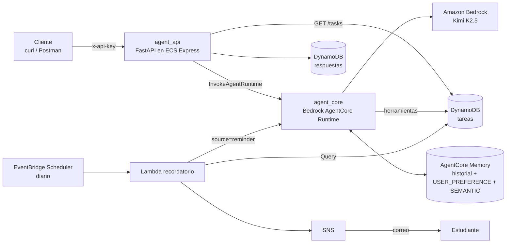

# Agente de seguimiento de tareas — Taller universitario

Aplicación de referencia de un **agente de IA** que gestiona tareas en lenguaje natural. Cada estudiante despliega su propia copia en AWS con Terraform.

Lo que hace el agente:

- **CRUD de tareas en lenguaje natural**: "Crea una tarea para entregar el ensayo de Historia el viernes".
- **Resúmenes de progreso**: "¿Cómo voy con Cálculo?".
- **Reportes de standup y de estado**: "Dame mi standup de hoy".
- **Recordatorios**: un correo diario con las tareas vencidas o próximas a vencer.
- **Planificación**: "Divide mi proyecto final de Bases de Datos en tareas".
- **Memoria a largo plazo**: recuerda tus preferencias (formato, prioridad por defecto, materias) entre conversaciones.

---

## Arquitectura



| Componente | Tecnología | Carpeta |
|---|---|---|
| Agente | LangChain `create_agent` (LangGraph) + `ChatBedrockConverse` (Kimi K2.5), servido con `BedrockAgentCoreApp` | `agent_core/` |
| API | FastAPI + autenticación con `x-api-key` + límite de peticiones (slowapi) | `agent_api/` |
| Infraestructura | Terraform (AgentCore Runtime y Memory, ECS Express, DynamoDB, Lambda, SNS, Scheduler) | `infra/` |

### Cómo está construido el agente

- **Herramientas** (`agent_core/tools/`):
  - `create_task`, `create_tasks_bulk`, `get_task`, `list_tasks`, `update_task`, `delete_task`, `summarize_progress`;
  - `get_current_datetime`;
  - `load_skill`, que la agrega `SkillMiddleware`.

  El `actor_id` nunca es un argumento de las herramientas: se toma del contexto de la petición. Así, el modelo no puede tocar las tareas de otra persona.
- **Prompt de sistema** (`agent_core/prompts/`): se compone de secciones (rol, modelo de datos, reglas de borrado, memoria, seguridad y estilo).
- **Skills** (`agent_core/skills/*/SKILL.md`): guías paso a paso que el agente carga cuando las necesita:
  - `goal_breakdown`: dividir un objetivo en tareas;
  - `standup_report`: reporte de standup y de estado;
  - `reminder_digest`: texto del recordatorio.
- **Middlewares** (`agent_core/middlewares/`):
  - `SkillMiddleware` agrega el catálogo de skills al prompt;
  - `MemoryMiddleware` guarda tus mensajes en AgentCore Memory y agrega al prompt las preferencias y hechos recordados.
- **Eliminación segura**: `delete_task` primero devuelve `confirmation_required` y solo borra con `confirmed=true` después de que confirmes en un mensaje nuevo.

### Modelo de una tarea

| Campo | Valores |
|---|---|
| `task_id` | Lo genera el sistema: `T-xxxxxxxx` |
| `title` | Obligatorio, máximo 200 caracteres |
| `description` | Opcional, máximo 2000 caracteres |
| `status` | `todo`, `in_progress`, `blocked`, `done` |
| `priority` | `low`, `medium`, `high`, `urgent` |
| `due_date` | `YYYY-MM-DD` (fecha local de tu zona horaria) |
| `tags` | Hasta 10 etiquetas en minúsculas |
| `created_at`, `updated_at`, `completed_at` | Marcas de tiempo UTC del sistema |

---

## Requisitos previos

1. **Una cuenta de AWS** con permisos para crear IAM, DynamoDB, ECR, ECS, Lambda, SNS, EventBridge Scheduler y Bedrock AgentCore.
2. **Acceso al modelo Kimi K2.5** en Amazon Bedrock (`us-east-1`): en la consola de Bedrock, ve a *Model access* y habilita *Moonshot AI – Kimi K2.5*.
3. **Herramientas locales**:
   - [AWS CLI v2](https://docs.aws.amazon.com/cli/latest/userguide/getting-started-install.html) configurado (`aws configure` o `aws configure sso`);
   - [Terraform](https://developer.hashicorp.com/terraform/install) ≥ 1.9;
   - [Docker](https://docs.docker.com/get-docker/) con **buildx**. AgentCore requiere imágenes `linux/arm64`; en equipos Intel/AMD, Docker Desktop ya incluye la emulación necesaria;
   - Python 3.13, solo para las pruebas locales;
   - `jq`, opcional, para los ejemplos con `curl`.

Comprueba que todo funciona:

```bash
aws sts get-caller-identity
terraform version
docker buildx version
```

---

## Despliegue paso a paso

```bash
cd task_agent/infra
cp terraform.tfvars.example terraform.tfvars
```

Edita `terraform.tfvars`:

| Variable | Descripción |
|---|---|
| `student_id` | Identificador único (minúsculas, números, `_`). Se usa para nombrar todos los recursos, por lo que varios estudiantes pueden compartir una cuenta. |
| `api_keys` | Tu clave de API (mínimo 20 caracteres). Genérala con `openssl rand -hex 24`. |
| `timezone` | Tu zona horaria IANA, por ejemplo `America/Mexico_City`, `America/Bogota` o `Europe/Madrid`. |
| `reminder_actor_id` | Tu `actor_id` (letras, números, `-`, `_`). Usa **el mismo** valor en tus llamadas a la API. |
| `reminder_email` | Correo para el recordatorio diario. Déjalo vacío para no crear recordatorios. |
| `aws_profile` | Opcional: perfil del AWS CLI. |
| `existing_subnet_ids` | Opcional: subredes públicas existentes si tu cuenta ya alcanzó el límite de VPCs. |

Despliega (tarda varios minutos: construye dos imágenes Docker y crea la memoria):

```bash
terraform init
terraform apply
```

Al terminar verás las salidas: `api_url`, `agent_runtime_arn`, `memory_id`, `memory_namespaces`, `tasks_table_name`…

> **Importante:** si configuraste `reminder_email`, revisa tu bandeja y **confirma la suscripción de Amazon SNS**. Sin esa confirmación no recibirás recordatorios.

---

## Probar la API

```bash
export API_URL=$(terraform -chdir=infra output -raw api_url)
export API_KEY="<la clave que pusiste en api_keys>"
export ACTOR_ID="<tu reminder_actor_id>"
export SESSION_ID="sesion-$(date +%s)"

chat() {
  curl -s -X POST "$API_URL/messages" \
    -H "x-api-key: $API_KEY" -H "Content-Type: application/json" \
    -d "$(jq -n --arg p "$1" --arg s "$SESSION_ID" --arg a "$ACTOR_ID" \
          '{prompt: $p, session_id: $s, actor_id: $a}')" | jq -r '.response // .'
}

curl -s "$API_URL/health"
```

### Ejemplos de conversación

```bash
# Crear
chat "Crea una tarea: entregar el ensayo de Historia el viernes, prioridad alta, etiqueta historia"

# Consultar
chat "¿Qué tareas tengo esta semana?"

# Actualizar
chat "Marca el ensayo de Historia como en progreso"
chat "Cambia la fecha del ensayo al próximo lunes"

# Eliminar (el agente pide confirmación primero)
chat "Elimina la tarea del ensayo de Historia"
chat "Sí, elimínala"

# Planificar un objetivo
chat "Ayúdame a preparar el examen final de Cálculo II del 15 de diciembre. Créame las tareas."

# Progreso y reportes
chat "¿Cómo voy en general?"
chat "Dame mi standup de hoy"
chat "¿Qué tengo vencido o por vencer?"
```

### Streaming (Server-Sent Events)

```bash
curl -N -X POST "$API_URL/messages" \
  -H "x-api-key: $API_KEY" -H "Content-Type: application/json" \
  -d "{\"prompt\": \"Resume mi progreso\", \"session_id\": \"$SESSION_ID\", \"actor_id\": \"$ACTOR_ID\", \"streaming\": true}"
```

### Respuestas largas

Si una respuesta síncrona tarda más de 50 s, la API devuelve `202` con `status: "IN-PROGRESS"` y un `response_id`. Consulta el resultado después:

```bash
curl -s "$API_URL/responses/<response_id>" -H "x-api-key: $API_KEY" | jq
```

### Endpoints

| Método | Ruta | Descripción |
|---|---|---|
| `GET` | `/health` | Estado del servicio (sin autenticación) |
| `POST` | `/messages` | Conversar con el agente. Cuerpo: `prompt`, `session_id`, `actor_id`, `streaming` (opcional) |
| `GET` | `/responses/{response_id}` | Resultado de una petición síncrona |
| `GET` | `/tasks?actor_id=…&status=…&priority=…&tag=…` | Listar tus tareas (solo lectura) |
| `GET` | `/tasks/{task_id}?actor_id=…` | Ver una tarea (solo lectura) |

```bash
curl -s "$API_URL/tasks?actor_id=$ACTOR_ID&status=todo" -H "x-api-key: $API_KEY" | jq
```

Todos los endpoints, excepto `/health`, requieren el encabezado `x-api-key` y tienen un límite de 10 peticiones por minuto. `actor_id` y `session_id` solo aceptan letras, números, `-` y `_`: es una restricción de AgentCore Memory, así que no uses `@` ni `.`.

---

## Memoria del agente

| Tipo | ¿Qué guarda? | Alcance |
|---|---|---|
| **Corto plazo** (historial) | Los mensajes de la conversación | Un `session_id` |
| **Largo plazo – USER_PREFERENCE** | Tus preferencias: formato, prioridad por defecto, horario, tono | Todas tus sesiones (mismo `actor_id`) |
| **Largo plazo – SEMANTIC** | Hechos de contexto: materias que cursas, proyectos, fechas importantes | Todas tus sesiones (mismo `actor_id`) |

Cómo funciona:

1. En cada mensaje, `MemoryMiddleware` guarda tu texto como evento en AgentCore Memory.
2. AgentCore extrae preferencias y hechos **en segundo plano**; tarda alrededor de 1–2 minutos.
3. En los siguientes mensajes, el middleware busca en `/tasks/user/<actor_id>/preferences/` y `/tasks/user/<actor_id>/semantic/` y agrega lo encontrado al prompt.
4. El estado de las tareas **siempre** sale de DynamoDB. La memoria solo personaliza las respuestas.
5. Los recordatorios automáticos leen tus preferencias, pero **no** escriben en la memoria.

### Pruébalo

```bash
chat "De ahora en adelante quiero que mis tareas nuevas tengan prioridad alta por defecto y que me respondas con tablas"

# Espera ~2 minutos y revisa los registros extraídos
MEMORY_ID=$(terraform -chdir=infra output -raw memory_id)
aws bedrock-agentcore list-memory-records --memory-id "$MEMORY_ID" \
  --namespace "/tasks/user/$ACTOR_ID/preferences/" | jq '.memoryRecordSummaries[].content.text'

# Nueva sesión, mismo actor: el agente aplica tus preferencias
export SESSION_ID="sesion-$(date +%s)"
chat "Crea una tarea para leer el capítulo 4 de Física"
```

Para borrar un recuerdo usa `aws bedrock-agentcore delete-memory-record --memory-id "$MEMORY_ID" --memory-record-id <id>`. `terraform destroy` elimina toda la memoria.

> **Privacidad:** no compartas datos sensibles (contraseñas, salud, documentos de identidad) en el chat: las conversaciones se procesan para la memoria a largo plazo.

---

## Recordatorio diario

- EventBridge Scheduler ejecuta la Lambda `<prefijo>-reminder` según `reminder_schedule_expression`. Por defecto es a las 08:00 en tu `timezone`.
- La Lambda revisa en DynamoDB si tienes tareas **vencidas o que vencen hoy o mañana**. Si no hay ninguna, no hace nada y no consume el modelo.
- Si hay tareas, le pide al agente un resumen (skill `reminder_digest`) y lo envía por correo con SNS.

Pruébalo sin esperar al día siguiente:

```bash
chat "Crea una tarea que venció ayer: repasar apuntes de Química"
aws lambda invoke --function-name "$(terraform -chdir=infra output -raw reminder_function_name)" /dev/stdout
```

---

## Desarrollo local

### Pruebas unitarias

```bash
# Agente
cd task_agent/agent_core
python3.13 -m venv venv && source venv/bin/activate
pip install -r requirements.txt
python -m unittest discover -s tests

# API
cd ../agent_api
python3.13 -m venv venv && source venv/bin/activate
pip install -r requirements.txt httpx
python -m unittest discover -s tests
```

### Chat local (sin desplegar el runtime)

Usa Bedrock y una tabla de DynamoDB reales; puedes usar la tabla que creó Terraform:

```bash
cd task_agent/agent_core
export AWS_REGION=us-east-1
export TASKS_TABLE_NAME=$(terraform -chdir=../infra output -raw tasks_table_name)
export USER_TIMEZONE=America/Mexico_City
# Opcional: usa también la memoria desplegada
export BEDROCK_AGENTCORE_MEMORY_ID=$(terraform -chdir=../infra output -raw memory_id)
python local_chat.py --actor-id "$ACTOR_ID"
```

---

## Costos y limpieza

Los principales costos mientras el stack está desplegado:

- **ECS Express (Fargate + balanceador)**: es el componente que corre todo el tiempo.
- **Bedrock**: tokens del modelo Kimi K2.5 en cada mensaje.
- **AgentCore**: tiempo de ejecución del runtime, eventos de memoria y extracción de memoria a largo plazo.
- **DynamoDB, Lambda, SNS, Scheduler**: costo mínimo con uso de taller.

Límites ya configurados para controlar el gasto:

- `MODEL_MAX_TOKENS=8192`;
- `RECURSION_LIMIT=50`;
- timeout de 300 s por petición;
- 10 peticiones por minuto;
- 1 tarea de ECS.

**Al terminar el taller, destruye todo:**

```bash
cd task_agent/infra
terraform destroy
```

---

## Solución de problemas

| Síntoma | Causa probable / solución |
|---|---|
| `AccessDeniedException` al invocar el modelo | Habilita el acceso a Kimi K2.5 en *Bedrock → Model access* de la región desplegada. |
| `exec format error` en el runtime | La imagen no es `linux/arm64`. Verifica `docker buildx version` y vuelve a ejecutar `terraform apply`. |
| `Memory is in transitional state` | Ejecuta `terraform apply` de nuevo; la memoria terminó de inicializarse. |
| 403 en la API | El encabezado `x-api-key` no coincide con `api_keys`. |
| 422 en la API | `actor_id`/`session_id` con caracteres no permitidos (`@`, `.`, espacios) o `prompt` vacío o de más de 4000 caracteres. |
| 429 en la API | Superaste 10 peticiones por minuto; espera un momento. |
| No llega el correo | Confirma la suscripción de SNS (revisa spam) y que `reminder_actor_id` sea el mismo `actor_id` que usas en el chat. |
| La Lambda falla con `Unknown service: 'bedrock-agentcore'` | El `boto3` del runtime de Lambda es antiguo. Empaqueta un `boto3` reciente junto con la función. |
| El agente "no recuerda" mis preferencias | Espera 1–2 minutos tras mencionarlas, usa el mismo `actor_id` y revisa los registros con `list-memory-records`. |
| `VpcLimitExceeded` | Define `existing_subnet_ids` con dos subredes públicas existentes en zonas distintas. |
